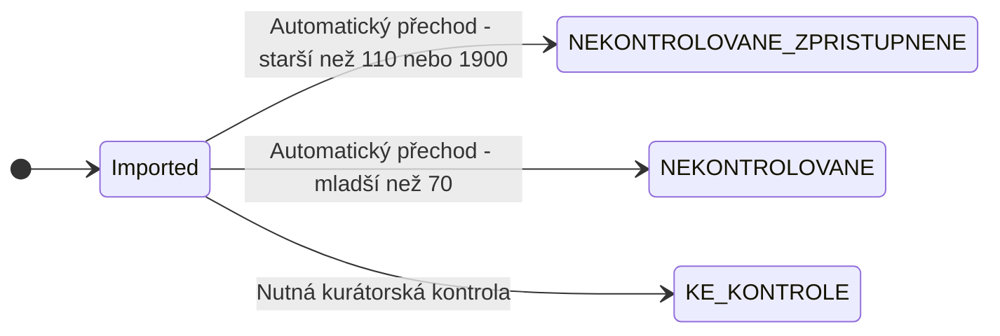
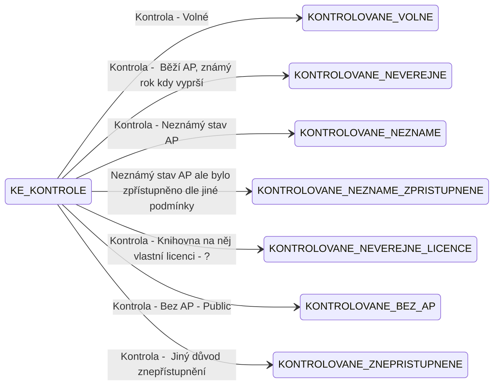
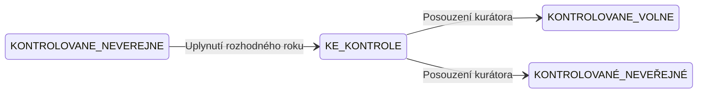
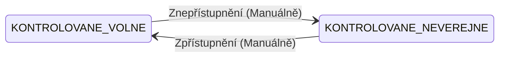

# NKP - Kurátorská aplikace

Aplikace zajistí komplexní správu veřejných a neveřejných dokumentů, včetně jejich zveřejnění v systému 
Kramerius.

Data jsou importováná z jednotlivých instancí krameria a dokumenty postupují nasledující stavy

## Sestavení

Backend vyžaduje Javu 21 a používá Maven Wrapper 3.9.9. Z kořenové složky repozitáře jej sestavíte a otestujete příkazem:

```powershell
.\mvnw.cmd clean verify
```

Kořenový Maven reactor obsahuje moduly v `services/` a `single-use-services/`. Knihovna `services/common` není samostatně spustitelná služba. Webová aplikace v `web-services/kuratorska-aplikace-web` má vlastní Maven build a vlastní GitHub Actions workflow; není součástí backendového reactoru.

GitHub Actions sestaví backend a web pro relevantní push změny a pull requesty. Po úspěšném pushi do výchozí větve publikuje obrazy `backend-build` a `web-build` do GitHub Container Registry repozitáře `ceskaexpedice/kapp`. Nastavení repozitáře, GHCR, Pages a deployment přihlášení popisuje [migrační návod](docs/deployment/github-actions.md).

## Dokumentace

Technická a provozní dokumentace je připravená jako statický web pomocí MkDocs Material.

- `docs/` obsahuje zdrojové Markdown stránky a statické soubory.
- `mkdocs.yml` definuje vzhled, navigaci a adresu webu.
- `mkdocs.local.yml` přepíná chat na lokální Documentation Chat API.
- `requirements.txt` připíná verzi MkDocs Material.
- `tools/` obsahuje build dokumentu pro LLM, publisher, build chatovacího UI a spouštěcí skript MkDocs.
- `.github/workflows/documentation.yml` sestaví a publikuje web přes GitHub Pages.

Složka `docs/` je jediným zdrojem udržované technické i uživatelské dokumentace a publikuje se jako jeden web.

### Lokální spuštění ve Windows 11

V PowerShellu z kořenové složky repozitáře spusťte:

```powershell
py -m venv '.venv'
.\.venv\Scripts\python.exe -m pip install --requirement 'requirements.txt'
.\tools\run_mkdocs.ps1
```

Web bude dostupný na adrese [http://127.0.0.1:8000/kapp/](http://127.0.0.1:8000/kapp/).

Výchozí konfigurace používá vzdálené Documentation Chat API. Pro lokální API spusťte:

```powershell
.\tools\run_mkdocs.ps1 -LocalChatApi
```

### Dokumentace pro LLM asistenta

Sloučený Markdown dokument vytvoříte příkazem:

```powershell
.\.venv\Scripts\python.exe '.\tools\build_kuratorska_aplikace_doc.py'
```

Výstup vznikne v `out/kuratorska-aplikace-doc.md`. Dokument lze odeslat do Documentation Chat API příkazem:

```powershell
.\.venv\Scripts\python.exe '.\tools\publish_kuratorska_aplikace_doc.py'
```

Publisher načítá URL a API klíč z argumentů, proměnných `DOC_CHAT_API_URL` a `DOC_CHAT_API_KEY` nebo ze souboru `%USERPROFILE%\.documentation-chat-api\doc_chat_api.json`.

### Chatovací UI v MkDocs

Angular Web Component a jeho profilové assety sestavíte a zkopírujete do `docs/assets/` příkazem:

```powershell
.\tools\build_documentation_chat_ui.ps1
```

Skript používá Angular projekt v `C:\VA\Projects\VA\documentation-chat\documentation-chat-ui`. Vygenerovaný JavaScript i profilová loga zůstávají verzované, protože GitHub Pages workflow spouští pouze MkDocs.

Přísnou kontrolu shodnou s GitHub Actions spustíte příkazem:

```powershell
.\.venv\Scripts\python.exe -m mkdocs build --strict --site-dir 'public'
```

### Publikování na GitHub Pages

Workflow `Documentation` se automaticky spustí po odeslání změn dokumentace do větve `main`. Před prvním během:

1. Otevřete **Settings → Pages**.
2. V části **Build and deployment** nastavte **Source: GitHub Actions**.
3. Zkontrolujte prostředí `github-pages` a jeho ochranu výchozí větve.

Web pak bude dostupný na adrese [https://ceskaexpedice.github.io/kapp/](https://ceskaexpedice.github.io/kapp/). Podrobnější postup je v [dokumentaci nasazení](docs/deployment/index.md) a [návodu pro GitHub Actions a GHCR](docs/deployment/github-actions.md).


## Import dokumentů


## Kurátorská kontrola



## Automatické přechody


## Možné přechody u existujících dokumentů

