# Kurátorská aplikace web - uživatelská dokumentace

Tento dokument popisuje běžnou práci ve webovém rozhraní Kurátorské aplikace: vyhledávání děl a autorů, kurátorské úpravy, dávky, evidenci smluv a administrační nastavení. Dokumentace je psaná pro koncové uživatele aplikace, nikoli pro správce infrastruktury.

## Snímky obrazovky

Tato verze obsahuje několik screenshotů pořízených z testovací aplikace `http://kapp-test.nkp.cz/`. Obrazovky vyžadující přihlášení nebo konkrétní kurátorskou akci jsou ponechané jako místa k doplnění.

Použité a navržené názvy souborů:

- `docs/img/01-rozcestnik.png` - úvodní obrazovka aplikace
- `docs/img/02-menu-a-jazyk.png` - horní menu, uživatelské menu a přepínání jazyka
- `docs/img/03-vyhledavani-dila-tabulka.png` - výsledky hledání děl v tabulkovém zobrazení včetně levého panelu facetů
- `docs/img/05-vyber-sloupcu.png` - dialog Výběr sloupců
- `docs/img/06-detail-dila.png` - rozbalený detail díla nebo kartové zobrazení
- `docs/img/07-zmena-stavu.png` - dialog Nastavit stav
- `docs/img/08-autor-v-dile.png` - dialog autora připojeného k dílu
- `docs/img/09-autori.png` - seznam autorů
- `docs/img/10-davky.png` - stránka Dávek
- `docs/img/11-smlouvy.png` - Evidence smluv
- `docs/img/12-detail-smlouvy.png` - detail smlouvy s PDF a přiřazenými díly; zatím k doplnění, protože testovací evidence smluv byla prázdná
- `docs/img/13-administrace.png` - administrace štítků, licencí a digitálních knihoven

## Účel aplikace

Kurátorská aplikace slouží ke kontrole a evidenci autorskoprávního stavu digitálních dokumentů. Uživatel v ní vyhledává díla a autory, doplňuje kurátorské informace, nastavuje výsledný stav díla, pracuje s dávkami dokumentů a eviduje smlouvy, které mohou ovlivnit způsob zpřístupnění.

Aplikace pracuje s daty z digitálních knihoven Kramerius a s autoritními záznamy. Rozhraní umožňuje proklik na původní dokument v digitální knihovně i na autoritní záznam autora.

Data proudí oběma směry. Backend Kurátorské aplikace sklízí bibliografická metadata z více instancí Krameria do společného úložiště. Kurátoři je následně kontrolují a upravují v tomto webovém rozhraní. Jednotlivé instance Krameria si změny licencí načítají zpět z HTTP rozhraní Kurátorské aplikace.

## Přihlášení

Horní menu obsahuje odkazy na hlavní části aplikace:

- **Díla** - vyhledávání a kontrola dokumentů.
- **Autoři** - vyhledávání a úprava autorů.
- **Dávky** - hromadná práce se skupinou dokumentů; dostupné po přihlášení.
- **Evidence smluv** - upload, evidence a přiřazování smluv; dostupné po přihlášení.
- **Administrace** - správa štítků, licencí a digitálních knihoven; dostupné po přihlášení.
- **Login / uživatelské menu** - přihlášení přes Keycloak a odhlášení přihlášeného uživatele.
- **Jazyk** - přepnutí rozhraní mezi češtinou a angličtinou.

Nepřihlášený uživatel může procházet veřejně dostupné seznamy děl a autorů. Kurátorské akce, jako je editace autora, změna stavu, práce s dávkami nebo smlouvami, vyžadují přihlášení.

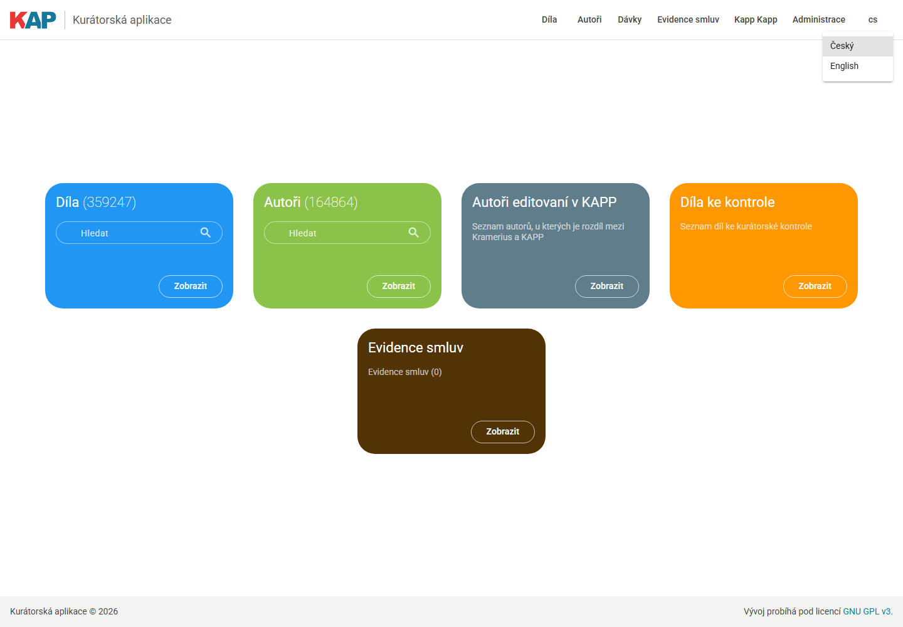

## Oprávnění

Rozsah dostupných akcí určuje přihlášení a role z Keycloaku:

- nepřihlášený uživatel může prohlížet díla a autory,
- přihlášený uživatel může pracovat se štítky a používat přihlášené části aplikace,
- role digitální knihovny opravňuje k úpravě titulů, jejichž sigly odpovídají knihovně,
- role `kappAdmin` umožňuje upravovat všechny tituly a spravovat mapování digitálních knihoven na sigly.

Aktuální role a povolené sigly uživatel najde v uživatelském menu v části **Oprávnění**. Jestliže hromadná operace obsahuje titul mimo oprávněné sigly, aplikace operaci nepovolí.

## Rozcestník

Úvodní stránka slouží jako rozcestník. Obsahuje karty pro rychlý vstup do nejčastějších agend:

- **Díla** - počet záznamů a vyhledávací pole pro přímý přechod do výsledků děl.
- **Autoři** - počet autorů a vyhledávací pole pro přímý přechod do výsledků autorů.
- **Autoři editovaní v KAPP** - filtruje autory, u kterých se data v aplikaci liší od dat z Krameria.
- **Díla ke kontrole** - otevře díla ve stavu určeném ke kurátorské kontrole.
- **Evidence smluv** - vstup do evidence smluv; zobrazuje se přihlášeným uživatelům.

Vyhledávací pole na kartách spustí hledání po stisknutí klávesy Enter nebo kliknutím na ikonu lupy. Tlačítko **Zobrazit** otevře příslušnou agendu bez zadaného dotazu.

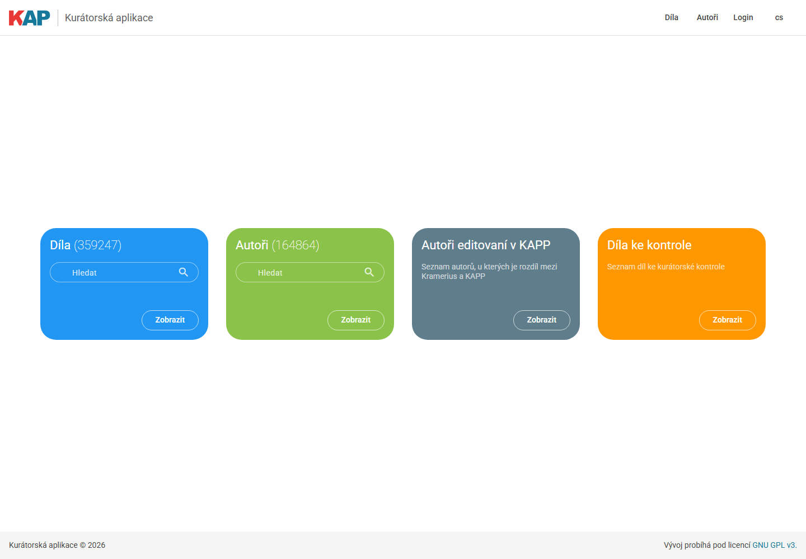

## Vyhledávání

Stránky **Díla** a **Autoři** mají podobné ovládání:

1. Do pole **Hledat** zadejte dotaz.
2. Vyhledávání spusťte klávesou Enter nebo ikonou lupy.
3. Ikona křížku v poli hledání smaže aktuální dotaz.
4. Výsledky lze zpřesnit facetami v levém panelu.
5. Stránkování je v horní části výsledků.

Stav hledání a filtrů je uložen v URL, takže lze odkaz na aktuální vyhledání předat dalšímu uživateli.

### Facety a filtry

Levý panel obsahuje filtry podle dostupných hodnot ve výsledcích. U děl se typicky používají:

- rok vydání,
- štítky,
- stav,
- změna uživatelem,
- dávka,
- smlouva,
- přiřazené licence,
- licence v digitální knihovně,
- digitální knihovna,
- model dokumentu,
- sigla,
- autoři.

U autorů jsou navíc dostupné rychlé filtry pro autory bez identifikátoru a autory bez roku úmrtí.

Aktivní filtry jsou zobrazeny v části **Vybrané filtry**. Kliknutím na položku s ikonou křížku se filtr odebere. U roku vydání a dat změny se zadává rozsah od-do.

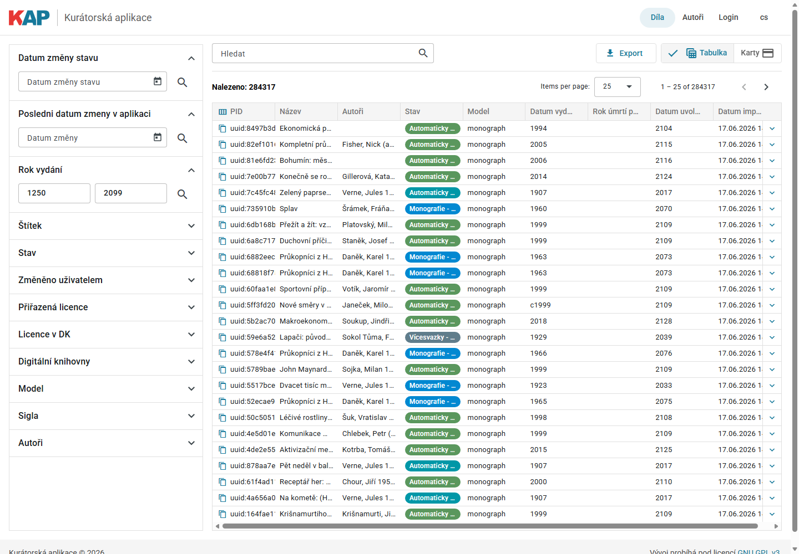

### Tabulkové zobrazení

Ve výsledcích děl je výchozí tabulkové zobrazení. Tabulka podporuje:

- řazení kliknutím na hlavičku sloupce,
- změnu šířky sloupců přetažením hranice sloupce,
- kopírování PID ikonou kopírování,
- rozbalení řádku ikonou šipky,
- výběr jednotlivých záznamů checkboxem,
- hromadné přiřazení vybraných záznamů do dávky nebo ke smlouvě,
- export aktuálního seznamu do CSV.

Přihlášenému uživateli se v tabulce zobrazují navíc akce pro práci s dávkami a smlouvami. U nepřihlášeného uživatele zůstává rozhraní primárně pro prohlížení.

### Výběr sloupců

Kliknutím na ikonu sloupců v hlavičce PID nebo přes kontextové menu tabulky se otevírá dialog **Výběr sloupců**.

V dialogu lze:

- zapnout nebo vypnout jednotlivé sloupce,
- změnit pořadí sloupců přetažením,
- uložit nastavení tlačítkem **Uložit**.

Nastavení sloupců a jejich šířek se ukládá lokálně v prohlížeči.

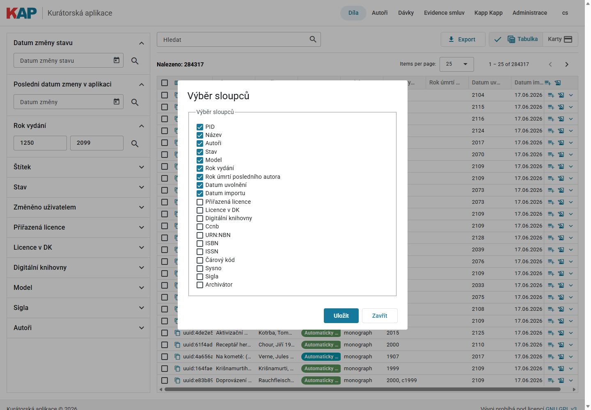

### Kartové zobrazení

Tlačítkem **Karty** lze přepnout výsledky děl do kartového zobrazení. Karta zobrazuje více metadat najednou a je vhodná pro kurátorskou práci nad jednotlivým dílem.

Karta díla obsahuje zejména:

- název a model dokumentu,
- štítky,
- typ díla: anonymní, kolektivní, úřední, pseudonymní,
- autory a role,
- posledního autora a rok úmrtí posledního autora,
- datum vydání,
- PID s odkazem do digitální knihovny,
- siglu a identifikátory,
- přiřazené licence a licence v digitální knihovně,
- digitální knihovnu,
- kurátorskou poznámku,
- rok uvolnění,
- u hierarchických dokumentů seznam částí.

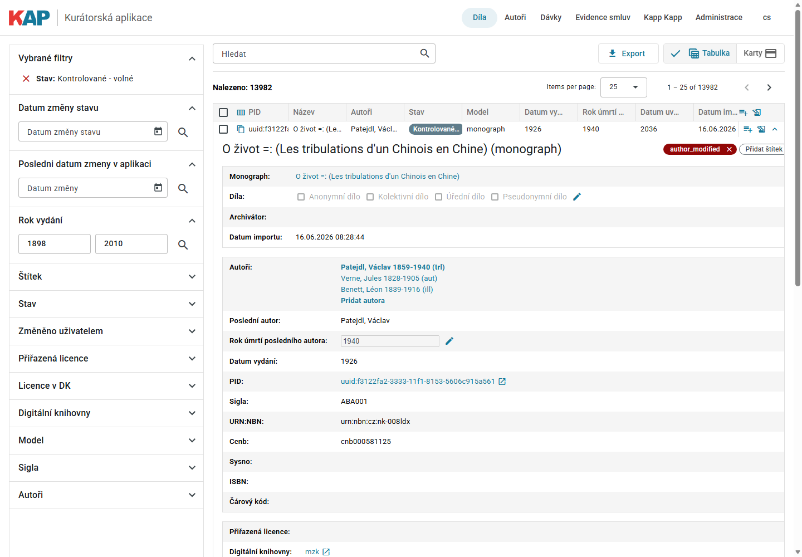

## Práce s dílem

### Štítky

Štítky slouží k operativnímu označení děl. Na kartě díla se štítky zobrazují jako barevné chipy. Nový štítek se přidá přes chip **Přidat štítek**. Štítek lze odebrat ikonou křížku na chipu.

Seznam dostupných štítků a jejich barvy se spravují v Administraci.

### Typ díla

Přihlášenému uživateli se u díla zobrazuje editace typu díla:

- **Anonymní dílo**,
- **Kolektivní dílo**,
- **Úřední dílo**,
- **Pseudonymní dílo**.

Kliknutím na ikonu editace se hodnoty odemknou. Po úpravě se změny uloží ikonou diskety, nebo zruší ikonou zrušení.

### Autoři díla

Seznam autorů spojuje autory evidované v KAPP a autory z Krameria. Kliknutím na autora se otevře dialog autora v kontextu konkrétního díla. Odkaz **Přidat autora** otevře stejný dialog pro nového autora.

U autora v díle lze:

- upravit jméno, příjmení, datum narození a úmrtí,
- doplnit identifikátor autority,
- upravit roli autora u díla,
- doplnit poznámku,
- přidat autora podle identifikátoru autority,
- označit autora jako posledního autora,
- odebrat označení posledního autora,
- odebrat autora z díla nebo odebrání vrátit,
- zobrazit původní data z Krameria, pokud existují,
- přehledat autory podle jména.

Pokud má autor `nameIdentifier`, aplikace zobrazuje odkazy na externí autoritní zdroje.

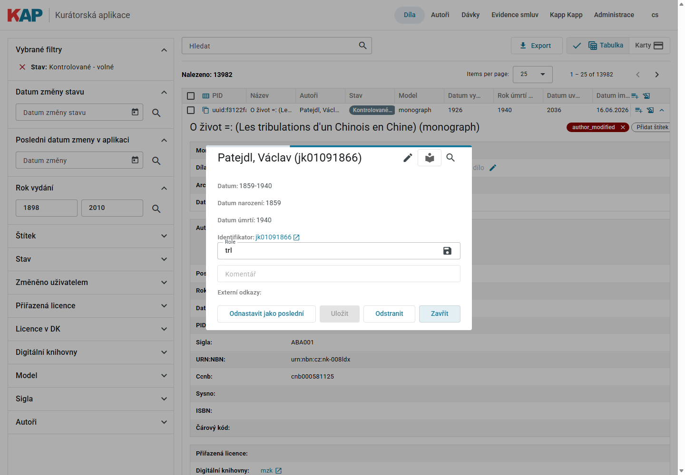

### Poslední autor

Rok úmrtí posledního autora je důležitý pro výpočet rozhodného roku a následné doporučení zpřístupnění. Lze jej upravit přímo na kartě díla nebo nastavením konkrétního autora jako posledního autora v dialogu autora.

### Poznámka

Přihlášený uživatel může u díla editovat pole **Komentář**. Editace se spouští ikonou tužky, uložení ikonou diskety.

### Odkaz do digitální knihovny

PID díla je odkazem do odpovídající digitální knihovny. Pro záznamy NKP se používá odkaz na `ndk.cz`, pro záznamy MZK odkaz na `digitalniknihovna.cz/mzk`.

## Nastavení stavu

Stav díla určuje výsledek kurátorské kontroly a související licenci. Stav lze měnit z tabulky kliknutím na stav nebo z karty díla tlačítkem se stavem.

Dialog **Nastavit stav** zobrazuje:

- aktuální stav,
- aktuální licence,
- výběr nového stavu,
- výběr licence, pokud je pro daný stav povolena editace licence,
- důvod změny,
- historii předchozích změn stavu.

Při uložení je vhodné vyplnit důvod změny tak, aby bylo z historie zřejmé, proč bylo rozhodnutí provedeno.

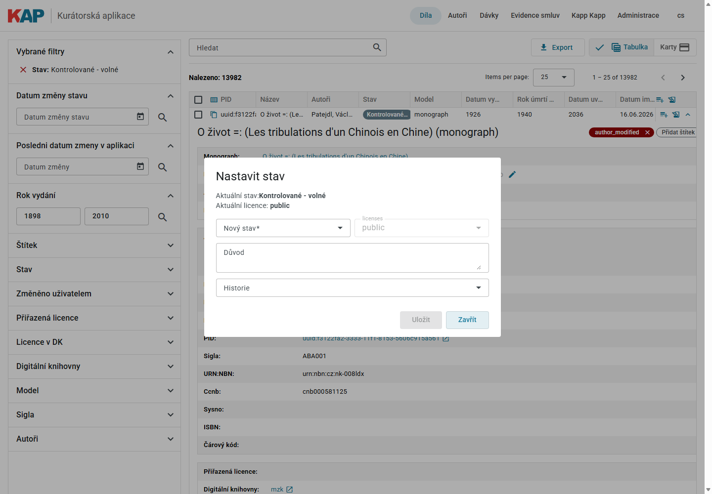

### Ruční kurátorské stavy

| Stav v rozhraní | Význam | Obvyklá licence |
| --- | --- | --- |
| Kontrolované - volné | Dílo bylo posouzeno jako veřejně dostupné. | `public` |
| Kontrolované - neveřejné | Dílo zůstává neveřejné. | `onsite` |
| Kontrolované - neznámé | Autorskoprávní stav nelze spolehlivě určit. | `onsite` |
| Kontrolované - neznámé - volné | Stav je neznámý, ale existuje jiný důvod pro zpřístupnění. | `public` |
| Kontrolované - bez autorských práv | Dílo není chráněno autorskými právy. | `public` |
| Kontrolované - znepřístupněné | Dílo má být znepřístupněno. | `onsite` |

Automatické stavy, jako **Automaticky PUBLIC**, **Automaticky ONSITE**, **Monografie - ke kontrole** nebo stavy rodičovských záznamů vícesvazkových děl, se mohou zobrazovat ve výsledcích a facetech podle importovaných dat a workflow aplikace.

## Autoři

Stránka **Autoři** slouží k vyhledávání a úpravě autoritních údajů používaných v aplikaci.

Karta autora zobrazuje:

- jméno autora a identifikátor,
- datum narození a úmrtí,
- poznámku,
- identifikátor autority a externí odkazy,
- štítky,
- počet děl, ve kterých je autor použit.

Přihlášený uživatel může autora upravit, uložit, označit štítkem a porovnat s autoritní databází pomocí tlačítka **Hledat autora v AUT**. Pokud aplikace najde odpovídající autoritní záznam, lze jej použít pro doplnění nebo sloučení údajů.

Tlačítko **Zobrazit díla** otevře seznam děl filtrovaný podle daného autora.

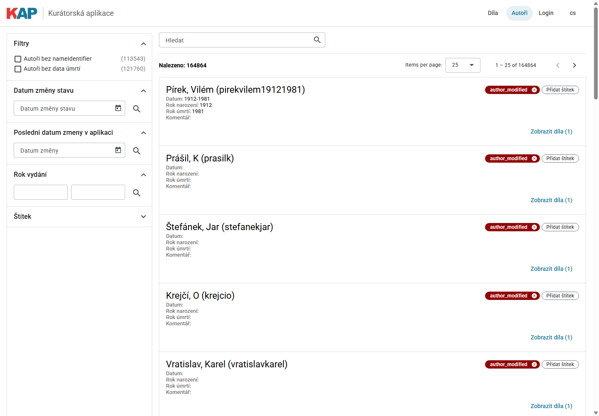

## Dávky

Dávky umožňují pracovat s více díly najednou. Stránka **Dávky** je dostupná po přihlášení.

Levý panel obsahuje seznam dávek. Kliknutím na název se dávka vybere a vpravo se zobrazí její obsah. Prázdnou dávku lze odstranit ikonou křížku.

### Vytvoření dávky

1. Do pole **Název nové dávky** zadejte název.
2. Klikněte na ikonu přidání.
3. Pokud dávka se stejným názvem existuje, aplikace zobrazí upozornění.
4. Změny se ukládají tlačítkem **Uložit**.

Dávku lze vytvořit také ze štítku tlačítkem **Vytvořit dávku ze štítku**. Aplikace vytvoří dávku z děl označených vybraným štítkem.

### Plnění dávky

Do dávky lze přidat díla:

- z výsledku vyhledávání děl přes akci **Přidat do dávky**,
- ručním zadáním PID na stránce Dávek,
- importem souboru do vybrané dávky.

V tabulce dávek lze PID zkopírovat, otevřít detail díla nebo dílo z dávky odebrat.

### Hromadná změna stavu

Tlačítko **Nastavit stav** otevře dialog pro hromadnou změnu stavu celé dávky. Dialog zobrazuje aktuální stavy obsažené v dávce a upozornění, že se změna týká celé dávky.

Před uložením hromadné změny je vhodné zkontrolovat, že dávka obsahuje pouze záznamy, na které se má rozhodnutí vztahovat.

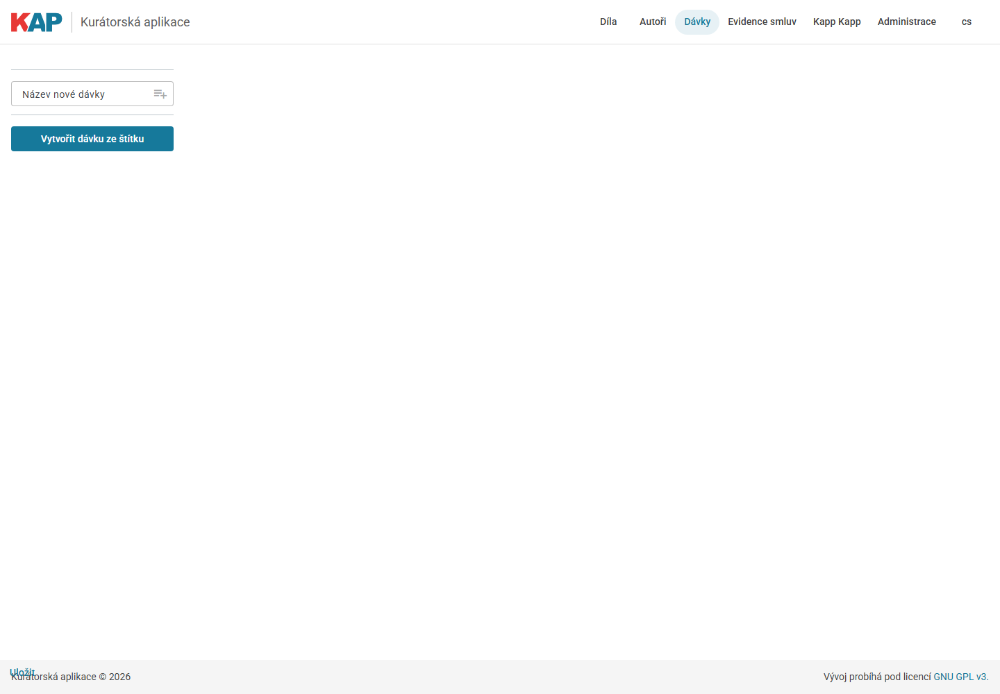

## Evidence smluv

Evidence smluv slouží k uploadu PDF smluv, doplnění metadat, přiřazení licencí a propojení smluv s díly.

Stránka **Evidence smluv** obsahuje:

- vyhledávací pole,
- tlačítko pro upload smlouvy,
- podporu přetažení souboru do upload zóny,
- checkbox **Analyzovat pomocí GEMINI**,
- tabulku smluv se sloupci podle konfigurace.

Pokud už soubor se stejným názvem existuje, aplikace zobrazí upozornění a nabídne přepsání.

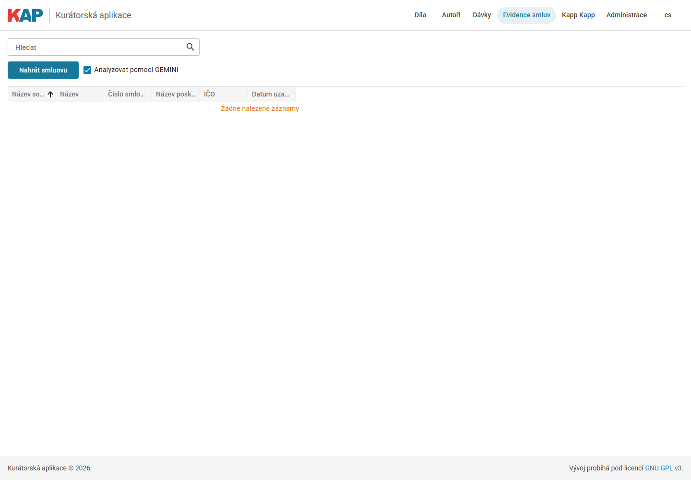

### Detail smlouvy

Kliknutím na název souboru v tabulce se otevře detail smlouvy. Dialog lze přesouvat za horní lištu.

V levém panelu se editují metadata:

- název,
- číslo smlouvy,
- datum uzavření,
- datum platnosti,
- poskytovatel,
- IČO,
- kontaktní osoby,
- licence,
- digitální knihovny,
- zda jde o hlavní smlouvu,
- dodatky nebo vazba na hlavní smlouvu,
- ČČNB,
- ISSN.

Pravá část obsahuje záložky:

- **Souhrn** - textový souhrn smlouvy.
- **PDF** - náhled PDF dokumentu.
- **Díla** - seznam děl přiřazených ke smlouvě a nástroje pro jejich vyhledání.

Tlačítko **Analyzovat** znovu spustí analýzu smlouvy. Tlačítko **Uložit** uloží metadata smlouvy.

> Screenshot k doplnění: `docs/img/12-detail-smlouvy.png` - detail smlouvy se záložkami Souhrn, PDF a Díla. V testovací aplikaci při pořizování dokumentace nebyl dostupný žádný záznam smlouvy.

### Přiřazení děl ke smlouvě

Díla lze ke smlouvě přiřadit dvěma způsoby:

- z výsledku vyhledávání děl akcí **Přidat do smlouvy**,
- v detailu smlouvy na záložce **Díla** pomocí tlačítka **Najít tituly**.

Vyhledání titulů ve smlouvě pracuje s identifikátory ČČNB a ISSN evidovanými u smlouvy. Nalezené tituly se zobrazí v samostatné tabulce a lze je přidat ke smlouvě. Při přiřazení lze současně změnit licence podle smlouvy, pokud je tato volba v dialogu zapnutá.

Přiřazené dílo lze ze smlouvy odebrat ikonou křížku v tabulce přiřazených děl.

## Administrace

Administrace je určena pro správu hodnot, které se používají v dalších částech aplikace.

### Štítky

V části **Administrace štítků** lze:

- upravit název štítku,
- doplnit poznámku,
- nastavit barvu,
- přidat nový štítek,
- odebrat uživatelský štítek,
- uložit změny.

Štítky definované v konfiguraci mohou být chráněné proti odebrání.

### Licence

V části **Administrace licencí** lze přidávat další licence používané ve smlouvách a při kurátorském rozhodování. Základní licence `public` a `onsite` jsou chráněné.

### Digitální knihovny

V části **Administrace digitálních knihoven** se spravuje seznam digitálních knihoven, které lze přiřazovat například ke smlouvám.

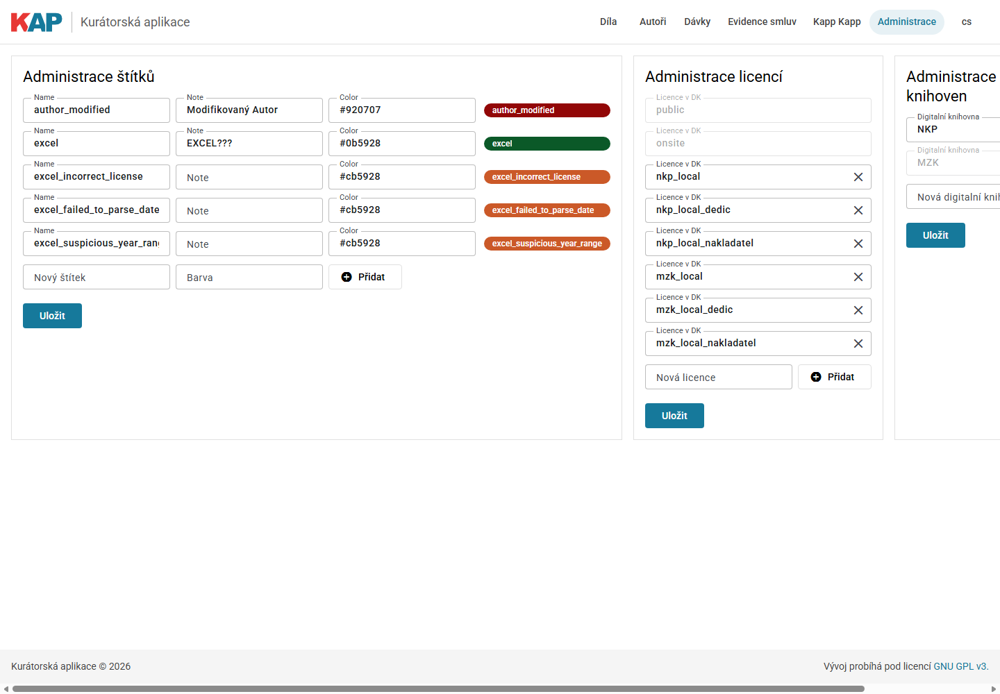

## Doporučený postup

1. Otevřete rozcestník a zvolte **Díla ke kontrole**, případně přejděte na **Díla** a nastavte filtr stavu.
2. Zužte seznam facetami podle modelu, digitální knihovny, sigly, roku vydání nebo dalších kritérií.
3. Otevřete detail díla.
4. Zkontrolujte autory, datum vydání, identifikátory a odkaz do digitální knihovny.
5. Podle potřeby doplňte nebo upravte autory, posledního autora a rok úmrtí.
6. Zaznamenejte poznámku nebo štítek, pokud je potřeba další práce nebo interní označení.
7. Pokud se na dílo vztahuje smlouva, přiřaďte ji z detailu díla nebo z Evidence smluv.
8. Otevřete dialog **Nastavit stav**.
9. Vyberte výsledný stav a licenci.
10. Doplňte důvod rozhodnutí.
11. Uložte změnu.

Pro hromadné rozhodování nejprve vytvořte dávku a zkontrolujte její obsah. Teprve potom použijte hromadnou změnu stavu.

## Hlášení a chyby

Aplikace zobrazuje potvrzení a chyby v horních notifikacích. Běžné úspěšné akce jsou například uložení záznamu, přidání záznamu, odebrání záznamu nebo zkopírování textu do schránky.

Pokud akce selže, zkontrolujte zejména:

- zda jste přihlášeni,
- zda máte pro akci oprávnění,
- zda je vyplněné povinné pole,
- zda není záznam už přiřazen nebo už existuje,
- zda je backend aplikace dostupný.

## Doplnění screenshotů

Při doplňování obrázků je vhodné použít testovací data, která neobsahují citlivé informace. U obrazovek se smlouvami doporučujeme použít testovací PDF nebo smlouvu určenou pro dokumentační ukázky.

Každý screenshot by měl ukazovat právě tu část UI, která je popisovaná v okolním textu. Není nutné vkládat obrázek ke každému tlačítku; největší hodnotu mají obrázky hlavní navigace, výsledků, detailu díla, dialogu změny stavu, dávek a detailu smlouvy.
