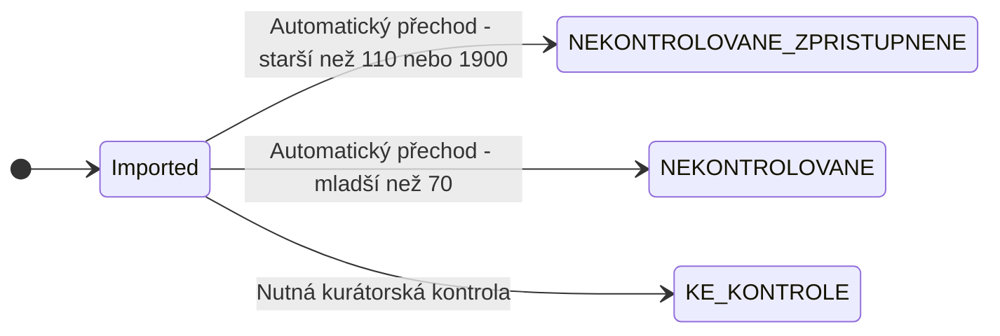
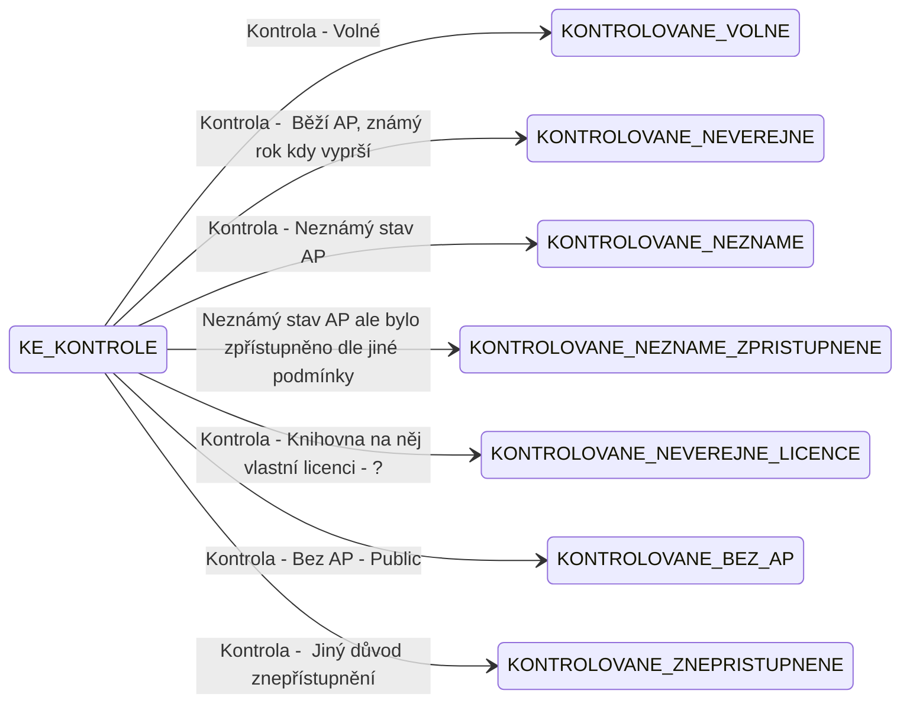
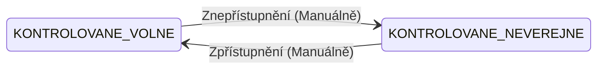

# NKP - Kurátorská aplikace

Aplikace zajistí komplexní správu veřejných a neveřejných dokumentů, včetně jejich zveřejnění v systému 
Kramerius.

Data jsou importováná z jednotlivých instancí krameria a dokumenty postupují nasledující stavy


## Import dokumentů


## Kurátorská kontrola



## Automatické přechody
```mermaid
stateDiagram-v2
    direction LR

    state Imported <<start>>
    state Konec <<end>>

    state NEKONTROLOVANÉ_ZPŘÍSTUPNĚNÉ : Automaticky přidělovaná licence public - Nedochází ke kurátorské kontrole (Monografie pred rokem 1900 a rocniky starsi nez 110 let)
    state NEKONTROLOVANÉ : Automaticky přidělovaná licence onsite - Nedochází ke kurátorské kontrole (Mapy, monografie a hudebniny vydané před méně než 70 lety)
    state KE_KONTROLE : Nutná kurátorská kontrola

    state KONTROLOVANÉ_VOLNÉ : Public (Volné AP)
    state KONTROLOVANÉ_NEVEŘEJNÉ : Private (Běží AP, s rozhodným rokem)
    state KONTROLOVANÉ_NEZNÁMÉ : Private (Neznámý stav AP)
    state KONTROLOVANÉ_NEZNÁMÉ_ZPŘÍSTUPNĚNÉ : Public (Neznámé AP, ale zpřístupněno)
    state KONTROLOVANÉ_NEVEŘEJNÉ_LICENCE : Public/Private (Neveřejné, ale s licencí)
    state KONTROLOVANÉ_BEZ_AP : Public (Dílo bez AP)
    state KONTROLOVANÉ_ZNEPŘÍSTUPNĚNÉ : Private (Znepřístupněno)


    %% Automatické přechody v čase
    KONTROLOVANE_NEVEREJNE --> KE_KONTROLE --> KONTROLOVANE_VOLNE : Uplynutí rozhodného roku
```

## Možné přechody u existujících dokumentů

